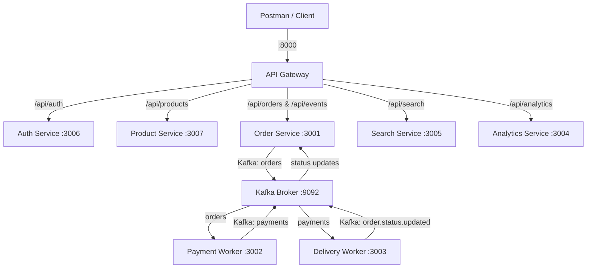

# Postman API Suite

Comprehensive API documentation, request specifications, and automated test suite for the Kafka Express E-Commerce Platform.

---

## 🧭 Navigation

- **[← Back to Root](../README.md)**
- **Services**:
  - [API Gateway](../services/api-gateway/README.md)
  - [Auth Service](../services/auth-service/README.md)
  - [Order Service](../services/order-service/README.md)
  - [Payment Service](../services/payment-service/README.md)
  - [Delivery Service](../services/delivery-service/README.md)
  - [Product Service](../services/product-service/README.md)
  - [Search Service](../services/search-service/README.md)
  - [Analytics Service](../services/analytics-service/README.md)
- **Packages & Tools**:
  - [Shared Package](../shared/README.md)
  - [Web Frontend](../web/README.md)
- **Guides**:
  - [01 Architecture & Overview](./documents/01-Architecture-and-Overview.md)
  - [02 Authentication & Security](./documents/02-Authentication-and-Security.md)
  - [03 End-to-End Testing](./documents/03-End-to-End-Testing-Workflows.md)
  - [04 Kafka Event Flow & SSE](./documents/04-Kafka-Event-Flow-and-SSE.md)

---

## Table of Contents

1. [Overview & Microservices Architecture](#overview--microservices-architecture)
2. [Service & Port Directory](#service--port-directory)
3. [Postman Workspace Formats](#postman-workspace-formats)
4. [Environment Variables](#environment-variables)
5. [End-to-End Test Execution Workflow](#end-to-end-test-execution-workflow)
6. [Automated Variable Chaining](#automated-variable-chaining)
7. [Running with Newman (CI/CD)](#running-with-newman-cicd)
8. [Role-Based Access Control (RBAC)](#role-based-access-control-rbac)
9. [Error & Status Code Reference](#error--status-code-reference)

---

## Overview & Microservices Architecture

The platform is an asynchronous, event-driven e-commerce platform communicating through Apache Kafka, with PostgreSQL for relational persistence, Redis for refresh token sessions, Elasticsearch for full-text search, and Prometheus for metrics aggregation.



---

## Service & Port Directory

| Service               | Port   | Endpoint URL / Base Path                            | Purpose                                                        |
| :-------------------- | :----- | :-------------------------------------------------- | :------------------------------------------------------------- |
| **API Gateway**       | `8000` | `http://localhost:8000`                             | Public reverse proxy, JWT validation, header injection         |
| **Auth Service**      | `3006` | `{{authServiceUrl}}` / `http://localhost:3006`      | Registration, login, JWT issuance, Redis refresh tokens        |
| **Order Service**     | `3001` | `{{orderServiceUrl}}` / `http://localhost:3001`     | Order placement, state machine, SSE streaming (`/api/events`)  |
| **Product Service**   | `3007` | `{{productServiceUrl}}` / `http://localhost:3007`   | Catalog search, category lists, admin CRUD                     |
| **Payment Service**   | `3002` | Internal Worker                                     | Consumes `orders`, 80% success rate, 3x backoff to `order.dlq` |
| **Delivery Service**  | `3003` | Internal Worker                                     | Consumes `payments`, stages: PREPARING -> SHIPPED -> DELIVERED |
| **Search Service**    | `3005` | `{{searchServiceUrl}}` / `http://localhost:3005`    | Elasticsearch full-text search indexer & query endpoint        |
| **Analytics Service** | `3004` | `{{analyticsServiceUrl}}` / `http://localhost:3004` | 1-min sliding window statistics & Prometheus `/metrics`        |

---

## Postman Workspace Formats

This workspace provides two interchangeable formats:

1. **Postman File-Based Format (Postman v11+ / Git Sync)**:
   - Located in `postman/collections/kafka-express-ecommerce-platform/` and `postman/environments/local.environment.yaml`.
   - Modifiable directly in Git with human-readable YAML files.
2. **Standard Postman v2.1.0 JSON Format**:
   - `postman/Kafka-Express-Ecommerce.postman_collection.json`: Import into any version of Postman, Insomnia, or Newman.
   - `postman/Local-Development.postman_environment.json`: Environment variable values.

---

## Environment Variables

| Variable              | Default Value           | Description                                                    |
| :-------------------- | :---------------------- | :------------------------------------------------------------- |
| `baseUrl`             | `http://localhost:8000` | API Gateway entrypoint                                         |
| `authServiceUrl`      | `http://localhost:3006` | Auth microservice direct URL                                   |
| `orderServiceUrl`     | `http://localhost:3001` | Order microservice direct URL                                  |
| `productServiceUrl`   | `http://localhost:3007` | Product microservice direct URL                                |
| `searchServiceUrl`    | `http://localhost:3005` | Search microservice direct URL                                 |
| `analyticsServiceUrl` | `http://localhost:3004` | Analytics microservice direct URL                              |
| `accessToken`         | `""`                    | Captured automatically from `Login` / `Refresh`                |
| `refreshToken`        | `""`                    | Captured automatically from `Login` cookie / response          |
| `productId`           | `""`                    | Captured automatically from `Get Products` or `Create Product` |
| `productId2`          | `""`                    | Secondary product ID captured from `Get Products`              |
| `orderId`             | `""`                    | Captured automatically from `Create Order`                     |
| `adminEmail`          | `admin@kafkashop.com`   | Default seed administrator email                               |
| `adminPassword`       | `admin123`              | Default seed administrator password                            |

---

## End-to-End Test Execution Workflow

To execute a complete test pass:

1. **Step 1: Health Checks**
   - Run `Health Checks / API Gateway Health`
   - Run `Health Checks / Auth Service Health`
   - Run `Health Checks / Order Service Health`
   - Run `Health Checks / Product Service Health`
   - Run `Health Checks / Search Service Health`
   - Run `Health Checks / Analytics Service Health`
2. **Step 2: Authentication**
   - Run `Auth / Login`: Uses admin credentials. Postman automatically captures `accessToken` and `refreshToken` into collection variables.
   - Run `Auth / Get Current User`: Confirms role and identity.
3. **Step 3: Products**
   - Run `Products / Get Products`: Fetches catalog and automatically captures `productId` and `productId2`.
   - Run `Products / Get Product by ID`: Validates specific product details.
   - Run `Products / Create Product`: Validates admin product creation (generates fresh `productId`).
4. **Step 4: Orders & Kafka Processing**
   - Run `Orders / Create Order`: Submits cart with `productId` and `productId2`. Emits `OrderCreatedEvent` to Kafka. Automatically stores `orderId`.
   - Run `Orders / Get My Orders`: Lists orders belonging to authenticated user.
   - Run `Orders / Get Order by ID`: Validates order lifecycle status (`PENDING`, `PREPARING`, `SHIPPED`, or `DELIVERED`).
5. **Step 5: Real-Time SSE Stream**
   - Run `Events (SSE) / Subscribe to Order Events`: Connects to `text/event-stream` to receive live status updates.
6. **Step 6: Search & Analytics**
   - Run `Search / Search Orders`: Searches indexed orders via Elasticsearch.
   - Run `Analytics / Get Realtime Metrics`: Fetches 1-minute throughput window.
   - Run `Analytics / Get Prometheus Metrics`: Scrapes Prometheus metrics exposition.

---

## Automated Variable Chaining

```text
[Auth: Login]
   │
   ├─► saves `accessToken` ──────────► [Injected into Bearer Auth headers]
   └─► saves `refreshToken` ─────────► [Used in Auth: Refresh Token]

[Products: Get Products]
   │
   ├─► saves `productId`  ───────────► [Used in Orders: Create Order & Products: Get by ID]
   └─► saves `productId2` ───────────► [Used in Orders: Create Order (line item 2)]

[Orders: Create Order]
   │
   └─► saves `orderId` ──────────────► [Used in Orders: Get by ID & Search: Get Order Document]
```

---

## Running with Newman (CI/CD)

### Install Newman

```bash
npm install -g newman newman-reporter-htmlextra
```

### Run Full Test Suite in Terminal

```bash
newman run postman/Kafka-Express-Ecommerce.postman_collection.json \
  -e postman/Local-Development.postman_environment.json \
  --reporters cli
```

### Run with HTML Report Export

```bash
newman run postman/Kafka-Express-Ecommerce.postman_collection.json \
  -e postman/Local-Development.postman_environment.json \
  -r cli,htmlextra \
  --reporter-htmlextra-export postman-report.html
```

---

## Role-Based Access Control (RBAC)

The API Gateway strictly enforces role permissions before proxying requests downstream:

| Route                             | Role             | Behavior                                               |
| :-------------------------------- | :--------------- | :----------------------------------------------------- |
| `/api/products` (POST/PUT/DELETE) | `admin`          | Allowed. Regular users receive `403 Forbidden`.        |
| `/api/products` (GET)             | Any / Public     | Allowed without authentication.                        |
| `/api/orders` (GET)               | `user`           | Returns only orders created by the user (`x-user-id`). |
| `/api/orders` (GET)               | `admin`          | Returns all orders across all users.                   |
| `/api/orders` (POST)              | `user` / `admin` | Allowed for any authenticated session.                 |
| `/api/search/*`                   | Authenticated    | Requires valid JWT token.                              |
| `/api/analytics`                  | Authenticated    | Requires valid JWT token.                              |

---

## Error & Status Code Reference

| Status Code        | Meaning                  | Common Cause                                                              |
| :----------------- | :----------------------- | :------------------------------------------------------------------------ |
| `200 OK`           | Request succeeded        | Standard response for GET, PUT, and order creations                       |
| `201 Created`      | Resource created         | Returned on `POST /api/auth/register` and `POST /api/products`            |
| `204 No Content`   | Deleted                  | Returned on `DELETE /api/products/:id`                                    |
| `400 Bad Request`  | Validation failure       | Missing required body fields, invalid UUIDs, or negative quantities       |
| `401 Unauthorized` | Missing / Invalid Token  | Missing Bearer token or expired JWT token                                 |
| `403 Forbidden`    | Insufficient Permissions | Non-admin attempting product CRUD, or user accessing another user's order |
| `404 Not Found`    | Resource Not Found       | Product or order UUID not found in database                               |
| `409 Conflict`     | Conflict                 | Registration with duplicate email address                                 |
| `500 Server Error` | Unhandled Error          | Internal error or database connection failure                             |
