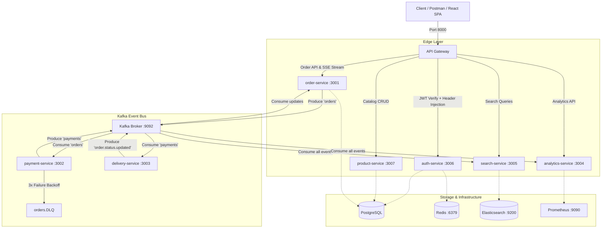

# Kafka Express E-Commerce Platform — System Architecture & Postman Documentation

This workspace contains the complete API collection, environment definitions, and testing workflows for the **Kafka Express E-Commerce Platform**, an event-driven microservices system built on Node.js, Express, Apache Kafka, PostgreSQL (Prisma), Redis, Elasticsearch, and React.

---

## 1. System Architecture Diagram



---

## 2. Port & Service Directory

| Service | Port | Base Path | Auth Requirement | Role |
| :--- | :--- | :--- | :--- | :--- |
| **API Gateway** | `8000` | `http://localhost:8000` | N/A | Single public entrypoint & reverse proxy |
| **Auth Service** | `3006` | `/api/auth` | Public / Bearer for `/me` | Registration, login, JWT issuance, Redis refresh sessions |
| **Product Service** | `3007` | `/api/products` | Public read, Admin write | Product catalog and category lookup |
| **Order Service** | `3001` | `/api/orders`, `/api/events` | Bearer Token | Order creation, retrieval, and SSE event streaming |
| **Payment Service** | `3002` | Worker | Internal Kafka | Consumes `orders`, simulates 80% success / 20% failure, retries 3x |
| **Delivery Service** | `3003` | Worker | Internal Kafka | Consumes `payments`, simulates courier stages every 5s |
| **Search Service** | `3005` | `/api/search` | Bearer Token | Elasticsearch full-text order indexing and search |
| **Analytics Service** | `3004` | `/api/analytics` | Bearer Token | 1-minute sliding window aggregations and Prometheus scraping |
| **Kafka Broker** | `9092` / `29092` | Internal / External | N/A | High-throughput distributed event broker |
| **Elasticsearch** | `9200` | Internal | N/A | Search engine and distributed analytics |
| **Redis** | `6379` | Internal | N/A | In-memory refresh token store (`refresh_token:<userId>`) |
| **PostgreSQL** | `5432` | Internal | N/A | Relational store for users, products, and orders |

---

## 3. Postman Workspace Directory Structure

```text
postman/
├── collections/
│   └── kafka-express-ecommerce-platform/
│       ├── .resources/
│       │   └── definition.yaml       # Main collection metadata & variables
│       ├── Health Checks/            # Service health endpoints
│       ├── Auth/                     # Register, Login, Refresh, Logout, Me
│       ├── Products/                 # Catalog search, details, admin CRUD
│       ├── Orders/                   # Create order, list orders, get by ID
│       ├── Events (SSE)/             # Server-Sent Events stream subscription
│       ├── Search/                   # Full-text Elasticsearch search & stats
│       └── Analytics/                # Real-time metrics & Prometheus scraping
├── environments/
│   └── local.environment.yaml        # Local Development environment variables
├── documents/
│   ├── 01-Architecture-and-Overview.md
│   ├── 02-Authentication-and-Security.md
│   ├── 03-End-to-End-Testing-Workflows.md
│   └── 04-Kafka-Event-Flow-and-SSE.md
├── Kafka-Express-Ecommerce.postman_collection.json  # Standard v2.1 import
├── Local-Development.postman_environment.json      # Standard v2.1 environment
└── README.md                         # Quickstart & Newman CI/CD guide
```
