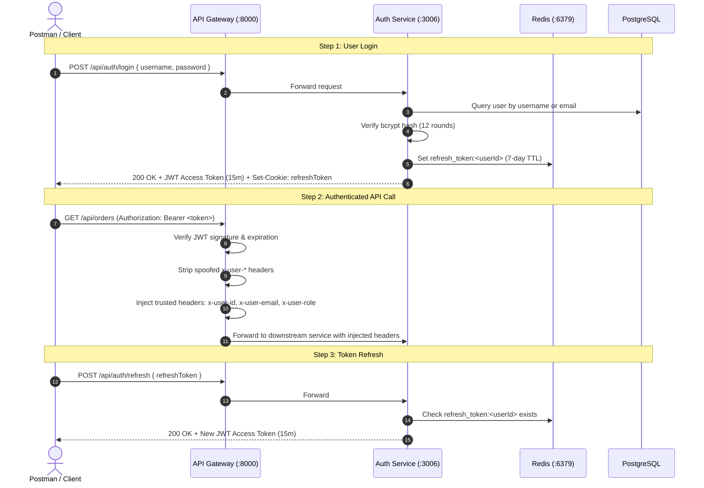

# Authentication, Security & Header Propagation

This document details the security architecture, token lifecycles, and role-based access control (RBAC) enforced across the platform and tested via Postman.

---

## 1. Authentication Lifecycle

---

## 2. Injected Security Headers

Downstream microservices (Order, Product, Search, Analytics) **never trust client-supplied identity**. The API Gateway strictly manages internal headers:

1. **Header Stripping**: The gateway strips incoming client headers `x-user-id`, `x-user-email`, and `x-user-role` on every request to prevent header spoofing.
2. **Signature Verification**: The gateway verifies the Bearer JWT against `JWT_SECRET`.
3. **Internal Header Injection**: Upon successful verification, the gateway injects:
   - `x-user-id`: Authenticated user UUID.
   - `x-user-email`: Authenticated user email address.
   - `x-user-role`: User role (`user` or `admin`).

---

## 3. Role-Based Access Control (RBAC) Matrix

| Endpoint | Method | Required Role | Behavior / Restriction |
| :--- | :--- | :--- | :--- |
| `/api/auth/register` | `POST` | Public | Creates `user` role account |
| `/api/auth/login` | `POST` | Public | Authenticates credentials, returns tokens |
| `/api/auth/refresh` | `POST` | Public | Refreshes access token via Redis check |
| `/api/auth/logout` | `POST` | Public | Deletes Redis session, clears cookie |
| `/api/auth/me` | `GET` | Authenticated | Returns current profile |
| `/api/products` | `GET` | Public | Browse catalog and apply filters |
| `/api/products/categories` | `GET` | Public | List categories |
| `/api/products/:id` | `GET` | Public | View single product |
| `/api/products` | `POST` | `admin` | Create product (403 if `user`) |
| `/api/products/:id` | `PUT` | `admin` | Update product (403 if `user`) |
| `/api/products/:id` | `DELETE` | `admin` | Delete product (403 if `user`) |
| `/api/orders` | `POST` | `user` or `admin` | Places order, emits Kafka event |
| `/api/orders` | `GET` | Authenticated | `user` sees own orders; `admin` sees all |
| `/api/orders/:id` | `GET` | Authenticated | Access limited to order owner or admin |
| `/api/events` | `GET` | Authenticated | SSE stream filtered to user's orders |
| `/api/search/*` | `GET` | Authenticated | Elasticsearch queries |
| `/api/analytics` | `GET` | Authenticated | Real-time sliding window stats |

---

## 4. Default Seed Credentials

- **Admin Account**:
  - Email: `admin@kafkashop.com`
  - Username: `admin`
  - Password: `admin123`
  - Role: `admin`
- **Dynamic Test Accounts**:
  - The `Auth/Register` request automatically utilizes Postman dynamic variables (`user_{{$timestamp}}@example.com`) to generate unique customer accounts for test runs.
