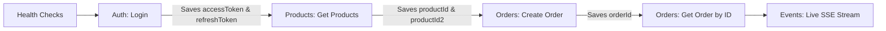

# End-to-End Testing & Automated Variable Chaining

This document explains how the Postman collection achieves fully automated, zero-configuration end-to-end test execution via automated variable extraction and chaining.

---

## 1. Automated Variable Chaining Pipeline

Each request in this collection automatically extracts required output values from responses and saves them to collection variables:



### Variable Extraction Details

1. **`Login` Request**:
   ```javascript
   const res = pm.response.json();
   if (res.accessToken) {
     pm.collectionVariables.set("accessToken", res.accessToken);
   }
   // Extract refresh token from cookie or Set-Cookie header
   const cookieVal = pm.cookies.get("refreshToken");
   if (cookieVal) {
     pm.collectionVariables.set("refreshToken", cookieVal);
   } else {
     const setCookie = pm.response.headers.get("Set-Cookie");
     if (setCookie) {
       const match = setCookie.match(/refreshToken=([^;]+)/);
       if (match) pm.collectionVariables.set("refreshToken", match[1]);
     }
   }
   ```

2. **`Get Products` Request**:
   ```javascript
   const res = pm.response.json();
   if (res.success && res.data && res.data.length > 0) {
     pm.collectionVariables.set("productId", res.data[0].id);
     if (res.data.length > 1) {
       pm.collectionVariables.set("productId2", res.data[1].id);
     }
   }
   ```

3. **`Create Order` Request**:
   ```javascript
   const res = pm.response.json();
   if (res.id) {
     pm.collectionVariables.set("orderId", res.id);
   }
   ```

---

## 2. Running with Postman Collection Runner

1. Open Postman.
2. Select the **Kafka Express E-Commerce Platform** collection.
3. Choose the **Local Development** environment.
4. Click **Run Collection**.
5. Select the desired order of execution:
   - `Health Checks`
   - `Auth`
   - `Products`
   - `Orders`
   - `Search`
   - `Analytics`
6. Click **Run Kafka Express E-Commerce Platform**.
7. Observe all assertions passing with green checkmarks.

---

## 3. Running Headless in CI/CD with Newman

You can execute the entire collection in terminal or CI/CD pipelines using Newman:

### Installation
```bash
npm install -g newman
```

### Run with Local Environment File
```bash
newman run postman/Kafka-Express-Ecommerce.postman_collection.json \
  -e postman/Local-Development.postman_environment.json \
  --reporters cli,junit \
  --reporter-junit-export newman-report.xml
```

### Run with HTML Report (with newman-reporter-htmlextra)
```bash
npx newman run postman/Kafka-Express-Ecommerce.postman_collection.json \
  -e postman/Local-Development.postman_environment.json \
  -r htmlextra \
  --reporter-htmlextra-export postman-report.html
```
