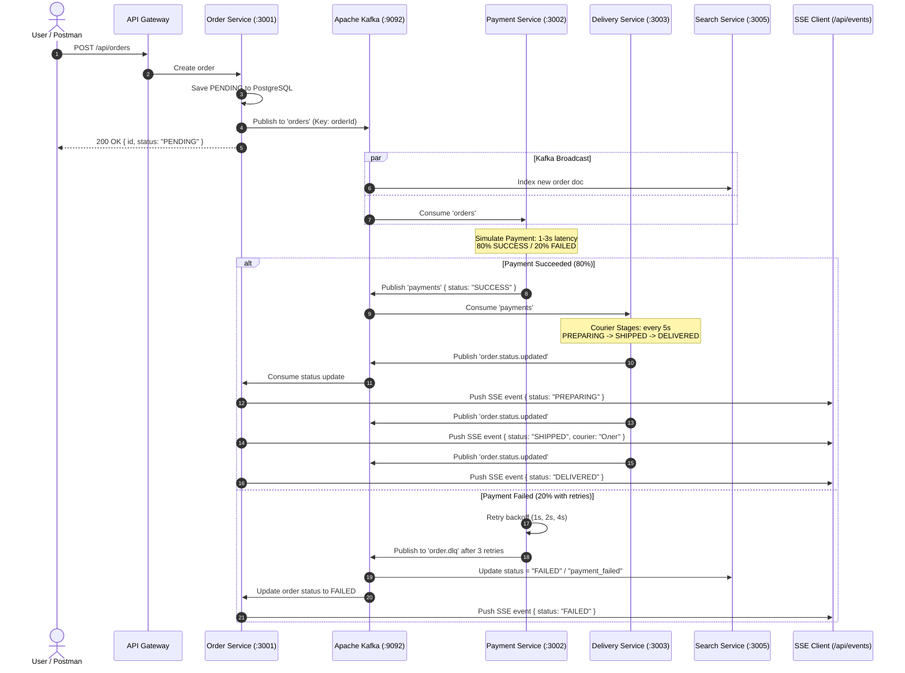

# Kafka Event Flow, Asynchronous Workers & SSE

This document details the event contracts, topic partitioning, retry mechanics, Dead Letter Queue (DLQ) behavior, and real-time Server-Sent Events (SSE) streaming.

---

## 1. Event Pipeline Diagram



---

## 2. Kafka Topic Contracts & Schemas

### 1. `orders` (`OrderCreatedEvent`)

- **Producer**: `order-service`
- **Consumers**: `payment-service`, `search-service`, `analytics-service`
- **Partition Key**: `orderId`

```json
{
  "orderId": "6b2a0c44-59e3-4de7-bd1c-1f4869871142",
  "userId": "9f7b1e88-34ab-4a55-b289-4b6d9e030991",
  "items": [{ "productId": "1a2b3c4d-...", "quantity": 2, "price": 129.99 }],
  "totalAmount": 259.98,
  "createdAt": "2026-10-13T21:00:00.000Z"
}
```

### 2. `payments` (`PaymentProcessedEvent`)

- **Producer**: `payment-service`
- **Consumers**: `delivery-service`, `search-service`, `analytics-service`
- **Partition Key**: `orderId`

```json
{
  "paymentId": "550e8400-e29b-41d4-a716-446655440000",
  "orderId": "6b2a0c44-59e3-4de7-bd1c-1f4869871142",
  "status": "SUCCESS",
  "processedAt": "2026-10-13T21:00:02.100Z",
  "failureReason": null
}
```

### 3. `order.status.updated`

- **Producer**: `delivery-service`
- **Consumers**: `order-service`, `search-service`, `analytics-service`
- **Partition Key**: `orderId`

```json
{
  "orderId": "6b2a0c44-59e3-4de7-bd1c-1f4869871142",
  "status": "SHIPPED",
  "courier": "Тарас",
  "updatedAt": "2026-10-13T21:00:07.300Z"
}
```

### 4. `order.dlq` (Dead Letter Queue)

- **Producer**: `payment-service` (on 3 exhausted retries)
- **Consumers**: `search-service`, alerting monitors

```json
{
  "originalMessage": { ... },
  "error": "Payment gateway timeout",
  "retryCount": 3,
  "failedAt": "2026-10-13T21:00:15.000Z"
}
```

---

## 3. Order Status Lifecycle

The complete set of order statuses used across the platform (PostgreSQL, Kafka events, SSE, and Elasticsearch index):

| Status | Source | Description |
| :--- | :--- | :--- |
| `PENDING` | Order Service | Initial state after order creation |
| `PAID` | Payment Service | Payment succeeded (intermediate state before delivery) |
| `PREPARING` | Delivery Service | Courier is preparing the shipment |
| `SHIPPED` | Delivery Service | Order dispatched to courier |
| `DELIVERED` | Delivery Service | Order successfully delivered |
| `FAILED` | Order Service / DLQ | Order failed after exhausting payment retries |
| `CANCELED` | Order Service | Order was explicitly canceled |
| `payment_failed` | Search Service | Elasticsearch-specific label for DLQ-routed failures |

> **Search filter note:** The `status` query parameter on `GET /api/search` accepts all values above. Use `CANCELED` (uppercase) for canceled orders and `payment_failed` (lowercase) for DLQ-indexed failures.

---

## 4. Server-Sent Events (SSE) Testing Guide

The endpoint `/api/events` streams live events to the authenticated user.

### Testing in Postman:

1. Ensure `accessToken` is populated (run `Auth/Login`).
2. Open `Events (SSE) / Subscribe to Order Events`.
3. Click **Send**.
4. Postman maintains an active, non-terminating connection.
5. In another tab, execute `Orders / Create Order`.
6. Watch the SSE response console: order status updates (`PREPARING`, `SHIPPED`, `DELIVERED`) will stream live as Kafka events are consumed!
